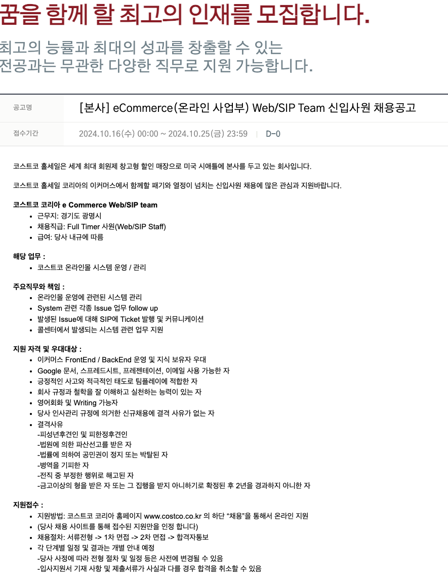

(이력서)[https://caumc.recruiter.co.kr/app/applicant/modifyResume?jobnoticeSn=180687&systemKindCode=MRS2]
(공고)[https://caumc.recruiter.co.kr/app/jobnotice/view?systemKindCode=MRS2&jobnoticeSn=180687]

# 자기소개서
## 자기소개서 (최소 100자, 최대 2,000자 입력가능)

[성장과정, 기회는 책임감에서]
군대에서 부모님의 보살핌에 보답하고자 스스로 점진적으로 목표를 세워 변화를 주게 되었습니다.

우선, 어학연수 계획을 세워, 휴가를 얻는 활동에 적극 참여하여, 중대에 가장 휴가를 많이 보유한 사람으로 3위라는 기록을 세웠습니다. 그 덕에 휴가 중, 단기 아르바이트를 통해 일정 금액을 모아 전역 후, 어학연수를 갈 수 있는 기회를 얻었습니다.
두 번째로, 대학교에서 근로로 참여해 책임감을 가지고 일에 임하였습니다. 저는 야간 대학교를 나와 주간 수업에는 참여할 수 없습니다. 그러나 주변 교직원분들의 추천으로 수업 도우미로 참여할 수 있게 되었고, 수업의 질을 올리기 위해 최선을 다한 결과 교수님을 만족시키면서, 다양한 기회를 얻었습니다.

지난 경험에서 책임감을 가지고 일을 끝까지 해낸다면, 인정을 받고 추천되어, 더 많은 기회가 주어진다는 것을 배웠습니다.이러한 가치관을 통해 코스트코에서 책임감을 가지고 일에 임하여 더 많은 기회를 얻고 싶습니다.

[장점, 신속한 학습과 적응력을 가진 개발자입니다.]
SI에서 다양한 코드 분석과 촉박한 개발 기간 동안 결과물을 가져와야 했던 근무 경험이 있습니다. 이러한 경험을 바탕으로 누군가가 저를 가르치는 인력을 줄일 수 있으며, 스스로 소스코드를 분석하고 파악하여, 업무에 보다 빠르게 적응할 자신이 있습니다. 작게나마 인력 소비를 줄여, 기술적 해결책을 제공함으로서, 사용자 만족도에 보다 빠르게 기여하는게 제 현실적 장점입니다.

[단점, 혁신적인 문제 해결사라고 표현하고 싶습니다.]
단점은 궁금한 점이 있으면 작게라도 직접 경험해야 하는 성격을 가지고 있습니다. 이로 인해 때때로 새로운 기술이나 방법에 추가적인 시간을 할애해야 하는 경우가 있습니다. 그러나 직접 손으로 무언가를 해보면서 얻은 지식은 훨씬 오래 지속되며, 다양한 지식은 저를 혁신적인 문제 해결사로 만들어줍니다.

이런 경험에서 얻은 장점과 단점을 적절하게 이용하여 회사에 보다 빠르게 적응해 성과를 이뤄내 나가겠습니다.

[지원동기, 코스토코에서 더 나은 이커머스 서비스 지원.]
부모님이 식사를 하시면, 운동겸 코스트코를 다닙니다. 저는 가족이 자주 방문하는 만큼 누구보다 신경써서 코스트코 프로그램을 고도화시키고 싶습니다. 완벽하다고 느껴도 완벽한 소프트웨어는 없기에 그 부분을 찾고, 해결하며, 코스트코와 함꼐 성장하고 싶습니다.

주로 경험이 SI이다 보니 사용자들의 요구사항을 듣고, 소스코드를 분석하여 개발은 매우 자신이 있습니다. 최근 네달 정도, 병원 SI로 개발하면서 수습기간이라 돈은 못 받아도 짧게는 10시간, 길게는 18시간 근무했습니다. 코스트코에서 맡은 부분과 필요한 부분은 성실하게 끝까지 책임감 가지고 개발하여, 기여하고 싶습니다.

지난번에 공고를 하루 놓처 아쉬운 마음에 짧게 메일도 보냈었는데, 이번 기회는 잡고자 지원하게 되었습니다.

[경력기술서]
- 서울대병원의 의료IT 기업인 이지케어텍에서 보라매병원 SI에 참여하여, C#, WPF를 활용한 윈도우 프로그램을 개발하였으며, 제가 맡은 파트는 원무/보험이였기에 요구사항과 간단한 설명으로 어렵지 않게 바로 개발을 할 수 있었고, 짧은 기간동안 16개의 화면을 개발했습니다. 특히, 의료IT는 쿼리가 매우 어렵기로 유명한데, 운이 좋게 옆에 계신 DBA분에게 배워 빠르게 기여하였습니다. 

- 메타넷디지털에서 지방세 관련 공공기관 SI 웹개발자로 근무하며, 신입으로 들어갔기 때문에 지방세외수입, 레저세, 지역자원시설세 등 주로 법 개정이 적은 항목을 담당하여 개발 및 유지보수를 진행하였습니다. 
또한 공무원분들의 시스템적 문의가 오기 때문에 각 세목에 업무를 숙지하고, 리눅스(Jeus)를 활용하여, Web Log 데이터를 모니터링 하거나 DB에 값이 제대로 들어갔는지 식별했습니다. 문제 발견 시에는 필요한 쿼리를 작성하여 실행 권한이 있는 상급자에게 부탁하거나 소스코드를 개선하여 해결하는 업무를 맡았습니다.

### 1차
[경력기술서]
서울대병원의 의료IT 기업인 이지케어텍에서 보라매병원 SI에 참여하여, C#, WPF를 활용한 윈도우 프로그램을 개발하였으며, 제가 맡은 파트는 원무/보험이였기에 요구사항과 간단한 설명으로 어렵지 않게 바로 개발을 할 수 있었고, 짧은 기간동안 16개의 화면을 개발했습니다. 특히, 의료IT는 쿼리가 매우 어려운데 운이 좋게 옆에 계신 DBA분에게 배워 빠르게 기여하였습니다. 
오픈 직후는 잠시 현장에서, 사용자들과 소통 및 실시간으로 문제가 생기면 식별하고, 보고하는 업무를 2주 간 맡은 경험도 있습니다. 개발자의 실수로 현창에서 카드리더기가 날라온다던가, 그런 상황이 발생하는 것을 직접 눈으로 본 이후에는 사용자들이 실수하지 않게, 더 정교하게 수정하거나 개발했습니다.

메타넷디지털에서 공공기관 SI 웹개발자로 근무하며, 저는 공공기관 금융 기술 분야에서 중요한 경험을 쌓고 다수의 성공적인 프로젝트를 이끌었습니다. 신입으로 들어갔기 때문에 지방세외수입, 레저세, 지역자원시설세 등 주로 법 개정이 적은 항목을 담당하여 개발 및 유지보수를 진행하였습니다. 
또한 공무원분들의 시스템적 문의가 오기 때문에 각 세목에 필요한 업무를 숙지하고, 리눅스를 활용하여, Web Log 데이터를 모니터링 하거나 DB에 값이 제대로 들어갔는지 확인했습니다. 문제 발견 시에는 SQL 쿼리를 작성하여 실행 권한이 있는 상급자에게 부탁하거나 소스코드를 개선하여 해결하는 업무를 맡았습니다.

